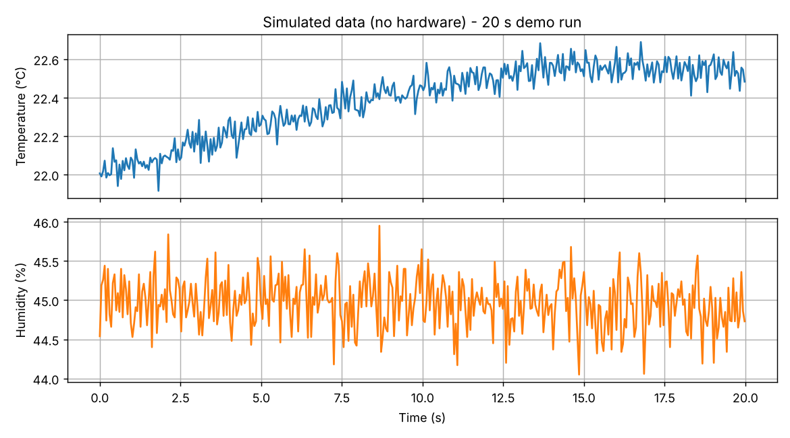

# Sensor Data Logger and Plotter

A small Python toolkit that reads temperature and humidity values from a microcontroller over a serial (UART) connection, saves them to a CSV file, plots them live or from a saved file, and calculates basic statistics (mean, noise, range, drift).

It works with real hardware or with a built-in simulator, so you can try it without any board.

## What it does

| Tool | Purpose |
|---|---|
| `src/logger.py` | Reads readings from a serial port (or the simulator) and writes them to a CSV file with timestamps |
| `src/plot.py` | Live plot from the serial port or simulator, or a plot of a saved CSV file |
| `src/analyze.py` | Calculates sample rate, mean, min/max, peak-to-peak, noise and drift for each channel |
| `firmware/arduino_sensor_uart/` | Example Arduino sketch (DHT11) that sends the data in the format the logger expects |
| `tests/` | Unit tests for line parsing, the analysis maths and the CSV logger |

## How it works

1. The microcontroller sends one text line per sample over UART: `temperature_c,humidity_pct`, for example `23.45,41.2`.
2. `sources.py` reads the lines and ignores broken ones (for example a half line when the connection starts). The simulator produces the same kind of readings, so the other tools do not care where the data comes from.
3. `logger.py` adds a timestamp and an elapsed time and writes a CSV file.
4. `analyze.py` removes a straight-line trend from each channel. The remaining spread is the **noise**, and the slope of the line is the **drift** per minute.

## Setup

Python 3.9 or newer.

```bash
git clone https://github.com/srinath-kothakapu/sensor-data-logger.git
cd sensor-data-logger
python -m venv .venv
# Windows: .venv\Scripts\activate      Linux/macOS: source .venv/bin/activate
pip install -r requirements.txt
```

## Usage

Try it without hardware (simulated data, 30 seconds):

```bash
python src/logger.py --simulate --duration 30 --out data/demo.csv
python src/analyze.py data/demo.csv
python src/plot.py --csv data/demo.csv --save docs/example_plot.png
```

With a real board (find the port in the Arduino IDE or Windows Device Manager, for example `COM3` or `/dev/ttyUSB0`):

```bash
python src/logger.py --port COM3 --baud 115200 --duration 120 --out data/run1.csv
python src/plot.py --live --port COM3
python src/analyze.py data/run1.csv
```

Run the tests:

```bash
python -m pytest
```

## Example output

The plot and numbers below come from the **simulator** (20 seconds, no hardware). They show what the tools produce and are not real sensor measurements.



```
Samples: 398   Duration: 20.0 s   Rate: 19.87 Hz

Temperature
  mean          22.387 °C
  peak-to-peak  0.774 °C
  noise (std)   0.0765 °C
  drift         +1.7145 °C/min
```

## Hardware example

The sketch in `firmware/arduino_sensor_uart/` sends DHT11 readings at 115200 baud, one per second. For another board (for example an STM32), send the same text format over UART. It needs the "DHT sensor library" by Adafruit.

## Project status

- Unit tests pass (`python -m pytest`).
- The simulator demo runs end to end.
- Hardware test with a real board: **not documented yet.** Add your own results here after you run the logger with your board, for example the board, sensor, port and what you measured.

## Possible improvements

- More channels (pressure, light) and a configurable line format
- Timestamps from the microcontroller instead of the PC
- Automatic port detection
- Export to other formats

## License

MIT, see `LICENSE`.
